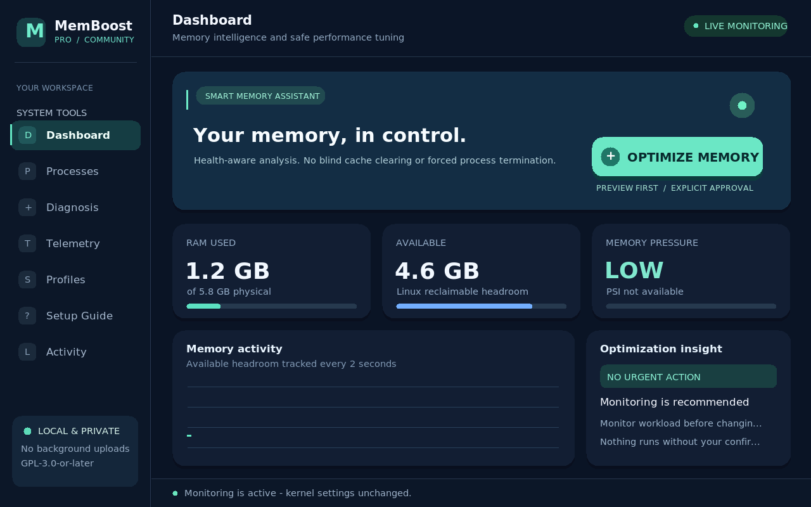
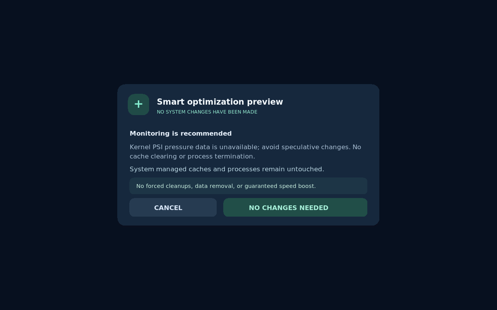

# MemBoost Pro Community — v3.2.0

**A Linux memory cockpit with a smarter, safer Optimize Memory button.** Native C++17/X11, no account or cloud dependency, GPL-3.0-or-later.



<details><summary><strong>See the optimization preview dialog</strong></summary>



</details>

## Download and installation

| Package | Direct repository download |
|---|---|
| Debian 13 x86-64 `.deb` | [Download DEB](downloads/v3.2.0/MemBoost-Pro-3.2.0-linux-amd64.deb?raw=1) |
| Linux x86-64 `.tar.gz` | [Download portable archive](downloads/v3.2.0/MemBoost-Pro-3.2.0-linux-amd64.tar.gz?raw=1) |
| Full GPL C++ source | [Download source](downloads/v3.2.0/MemBoost-Pro-3.2.0-source.tar.gz?raw=1) |
| Full download ZIP | [Download complete bundle](downloads/v3.2.0/MemBoost-Pro-3.2.0-download-bundle.zip?raw=1) |
| Checksums / release notes | [SHA-256](downloads/v3.2.0/SHA256SUMS.txt) · [Release notes](downloads/v3.2.0/RELEASE-NOTES.md) |

**Note:** These files are repository-hosted distributions. [GitHub Releases](https://github.com/sudipdasin/memory-booster/releases) is a separate publishing step and may have no formal entry until the owner publishes one. The package was built on Debian 13 x86-64; an independently built Ubuntu 24.04 VM package is exercised in CircleCI. Older distributions, other CPUs and Wayland-only sessions are **not** certified by these results.

```bash
sudo apt install ./MemBoost-Pro-3.2.0-linux-amd64.deb
memboost --self-test
memboost --gui
```

## Optimize Memory — how it actually works

1. Click the prominent **OPTIMIZE MEMORY** button on the dashboard, or run `memboost --optimize` in a terminal.
2. The app reads RAM headroom, Linux PSI memory stalls, swap availability, cgroup constraints and current swappiness/VFS tuning values. No configuration is changed by the preview.
3. **Healthy, unknown or unsafe conditions:** the app recommends monitoring or investigation. It does *not* claim fake RAM gains, kill applications, clear useful filesystem caches or cycle swap.
4. **Moderate sustained stalls plus sufficient headroom:** if appropriate, it **offers** an optional temporary `responsive` profile (swappiness 20, VFS cache pressure 75). You must confirm it, and administrator authorization is required. Values are verified and rollback is attempted if a write fails. Your workload may or may not benefit.

```bash
memboost --optimize --dry-run          # read-only preview
pkexec memboost --optimize --yes       # opt-in conditional action
memboost --diagnose                   # read-only health report
memboost --track --samples 5 --interval-ms 1000 --format jsonl
```

**There is no risk-free universal “boost memory” command.** Linux manages useful page cache automatically; unnecessary eviction or forced process termination can *reduce* performance or lose data. This application favors actual measurements and user control.

## Features

- Seven-section modern dark UI, keyboard shortcut `O` for the Optimize preview and `Esc` to cancel.
- Live RAM, swap, available headroom, PSI, 120-point memory graph, cgroup limits and process RSS.
- Read-only paging, swap-in/swap-out, OOM telemetry and bounded JSONL sampling.
- Three advanced, temporary tuning profiles with explicit confirmation; no unattended kernel writes.
- Optional anti-aliased Xft text using the desktop's installed system fonts; core-X11 fallback when Xft is unavailable. **No font files are bundled.**
- Native Debian/TGZ packaging, source archive, SHA-256 manifest, CircleCI jobs and independent Ubuntu 24.04 machine-VM install/uninstall test.

## Build, test and contribute

```bash
cmake -S . -B build -DCMAKE_BUILD_TYPE=Release -DMEMBOOST_BUILD_GUI=ON
cmake --build build --parallel 2
ctest --test-dir build --output-on-failure
python3 scripts/public_release_audit.py
python3 scripts/make_release.py --build-dir build-package
```

C++17, CMake >= 3.16 and Linux with X11 development headers are needed for the native GUI build. CLI-only builds work without X11. The optional text renderer dynamically loads the system's `libXft.so.2` if present. No GTK/WebView runtime is needed.

**License:** GNU General Public License version 3 or later ([GPL-3.0-or-later](LICENSE)) for current Community source, retaining historic MIT notices in [COPYRIGHT.md](COPYRIGHT.md) and [LICENSES/MIT-legacy.txt](LICENSES/MIT-legacy.txt). Previously granted MIT rights for older versions are not revoked.

**Repository governance:** changes to the official project require owner-approved PRs, with enforced GitHub branch rulesets configured by the owner. `.github/CODEOWNERS` is an intent file, not a substitute for active branch protection. Only CircleCI is used for CI; GitHub Actions is not used. See [Contributing](CONTRIBUTING.md), [Security](SECURITY.md), [Release governance](docs/RELEASE_GOVERNANCE.md), [Release publishing](docs/RELEASE_PUBLISHING.md) and [Public readiness](docs/PUBLIC_READINESS.md).
