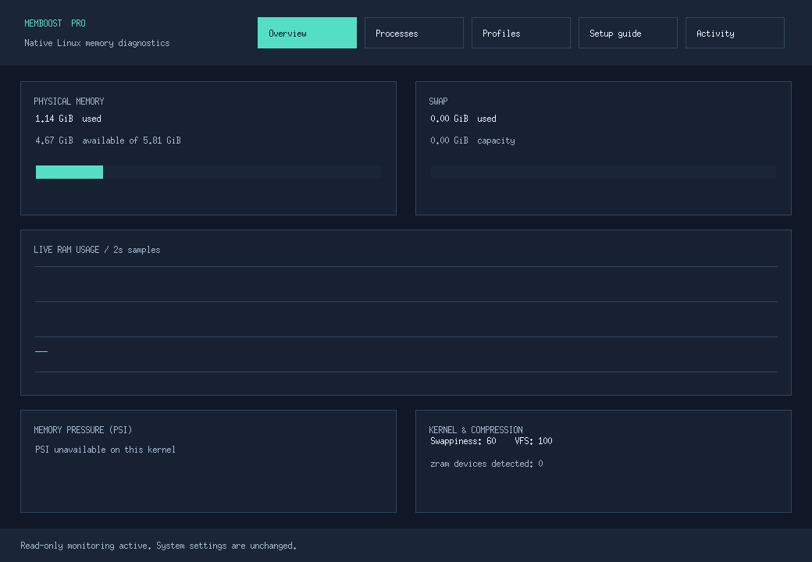

# MemBoost Pro

**Development milestone: v0.3.0** (local tests passed; CircleCI pending). The last packaged distribution remains v0.1.1 until the next fully validated release. This repository remains private during the public-readiness review.

See [Public readiness checklist](docs/PUBLIC_READINESS.md), [Security](SECURITY.md), and [Contributing](CONTRIBUTING.md). All source is available under the proposed [MIT License](LICENSE); the repository owner must review this irrevocable public-grant decision before changing visibility.

**v0.1.1 — downloadable Linux release (Debian 13 x86-64 baseline).** The private repository provides verified local packages directly on the GitHub homepage; this does **not** mean a GitHub Releases entry was created. Packages for other distributions are not certified.

## Download / Install

| Package | Download |
|---|---|
| Debian 13 / compatible amd64 `.deb` | [**Download DEB**](downloads/v0.1.1/MemBoost-Pro-0.1.1-linux-amd64.deb?raw=1) |
| Linux amd64 archive (`.tar.gz`) | [Download portable archive](downloads/v0.1.1/MemBoost-Pro-0.1.1-linux-amd64.tar.gz?raw=1) |
| C++ source (`.tar.gz`) | [Download source](downloads/v0.1.1/MemBoost-Pro-0.1.1-source.tar.gz?raw=1) |
| Complete ZIP / checksums / notes | [Download bundle](downloads/v0.1.1/MemBoost-Pro-0.1.1-download-bundle.zip?raw=1) · [SHA-256](downloads/v0.1.1/SHA256SUMS.txt) · [Release notes](docs/releases/v0.1.1.md) |

```bash
sudo apt install ./MemBoost-Pro-0.1.1-linux-amd64.deb
memboost --status
memboost --gui
```

**Compatibility:** Linux x86-64, X11 or XWayland for GUI, and on Debian package builds **glibc ≥ 2.38 / libstdc++ ≥ 13.1**. Not compatible with all Ubuntu/Mint versions; build from source on older systems. The portable tarball is still dynamically linked and has the same minimum shared-library versions. The repository is private, so GitHub downloads require an authorized account.



*Actual screenshot of the native X11 dashboard under a virtual X11 display. Diagnostic values depend on the system.*

**Release gate:** Local GUI/headless builds, 8 tests each, sanitizer tests, packaging and extracted-package smoke tests pass. CircleCI execution on this commit, independent distro/VM testing, signature verification and GitHub Releases asset hosting remain unverified. **Do not describe this as universally stable across distributions.**

Native **C++17** Linux memory diagnostics and guarded tuning with a graphical desktop dashboard and headless CLI. Built for Linux distributions exposing procfs and sysfs, with an X11 GUI (also runs through XWayland where available).

## What works

- Live RAM, swap, memory pressure (PSI), and zram diagnostics
- Largest resident-memory processes, bar graphs and history chart
- A five-tab desktop GUI with Overview, Processes, Profiles, Setup guide and Activity
- Read-only operation by default, no root login required
- Three documented, temporary kernel tuning profiles (only swappiness and VFS cache pressure)
- Confirmation dialog plus PolicyKit elevation at the point of applying a profile
- Kernel value readback and rollback attempts on failure; no system service restarts
- Unit tests, CLI smoke tests, CMake builds, CircleCI configuration and Debian packages

**Caution:** Linux uses spare memory for useful caches; a low 'free RAM' count does not necessarily mean a problem. The app does not claim to create physical RAM or promise a universal speed boost. `zram`, `zswap`, `oomd`, clearing caches, disabling swap and changing overcommit are deliberately not automatic.

## Build

```sh
# Debian / Ubuntu: sudo apt install build-essential cmake libx11-dev
cmake -S . -B build -DCMAKE_BUILD_TYPE=Release
cmake --build build --parallel
ctest --test-dir build --output-on-failure
./build/memboost --gui
```

For headless Linux: `cmake -S . -B build -DMEMBOOST_BUILD_GUI=OFF`.

## CLI

```sh
memboost --status             # Human-readable read-only snapshot
memboost --json               # Machine-readable snapshot
memboost --recommend          # Snapshot and suggested profiles
memboost --apply balanced --dry-run
pkexec memboost --apply responsive --yes  # Explicit temporary changes
```

Do not launch the GUI with sudo. It runs as a normal user, requesting administrator permission only for controlled kernel writes. Profiles change current runtime settings but **do not persist after reboot**. Before tuning, record your system's baseline.

## Packages

```sh
cmake -S . -B build -DCMAKE_BUILD_TYPE=Release
cmake --build build --parallel
cd build && cpack -G DEB && cpack -G TGZ
```

Install generated `.deb` with `sudo apt install ./memboost-pro-*.deb`. For other distros use a CMake source build or the tarball and install the binary as appropriate. A full GUI requires a working X11/XWayland display; Wayland-only systems without XWayland can use the CLI.

## CI

Per [CI provider policy](docs/CI_PROVIDER_POLICY.md), this repository uses **CircleCI exclusively** for automated checks. GitHub Actions is not used. CircleCI enrollment is observed. Pushes and pull requests trigger its build, test, virtual-display smoke test and packaging jobs; consult the repository commit status for the current result. Build artifacts are uploaded to CircleCI. On a version tag, an optional CircleCI publisher can create a GitHub Releases entry **only if** a protected `GITHUB_TOKEN` has been configured; neither token availability nor publisher execution is assumed. Packages are independently distributed through the versioned `downloads/` folder on the homepage.

## Security and non-goals

- No shell interpolation or user-provided command execution
- No startup modifications, persistent systemd overrides or hidden daemon
- No swapoff, zram teardown, forced cache flushes or process termination
- Application state is in-memory only; runtime kernel changes reset on reboot
- Rollback is best-effort; if kernel writes or verification fail, inspect with `sysctl vm.swappiness vm.vfs_cache_pressure`
- PSI and zram require kernel support and are detected, not presumed

Report defects using Issues. Include distribution, kernel version, X11/Wayland environment, `memboost --status` output with process names redacted where appropriate, and reproducible steps.

## Source provenance

Rebuilt from the user-supplied `Memboost Pro.txt` initial GTK3 concept to fix compilation and safety defects. This project does not redistribute that draft verbatim.

## Licensing

Proposed public-source license: [MIT](LICENSE), for review before making this repository public. The current repository remains private.
