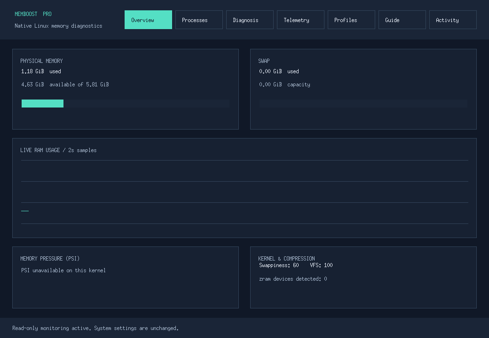

# MemBoost Pro Community — v3.0.1 GPL public-readiness candidate

**Native C++17 Linux memory diagnostics and conservative, confirmed tuning.** The owner has approved the **GNU General Public License version 3 or later** for this Community release. The official repository remains **private** until the owner completes GitHub review, merges the release candidate and explicitly changes visibility.

## License and public development

**License: [GPL-3.0-or-later](LICENSE)** · [Copyright and original MIT notices](COPYRIGHT.md) · [Preserved historical MIT notice](LICENSES/MIT-legacy.txt) · [Review governance](docs/RELEASE_GOVERNANCE.md)

Anyone may use, modify and redistribute the Community code in compliance with GPL, including commercial redistribution. This does **not** authorize modifying the canonical repository without accepted pull requests. Owner review must be enabled in GitHub branch rules; CODEOWNERS alone is not enforcement.

**Historical release note:** earlier artifacts through v3.0.0 remain available under their original MIT license grants. Changing this checkout's license does not retract previously granted MIT rights or relicense previous binaries retroactively.

## Downloads: v3.0.1 Linux review candidate

| File | GitHub versioned download |
|---|---|
| Debian 13 x86-64 `.deb` | [Download Debian package](downloads/v3.0.1/MemBoost-Pro-3.0.1-linux-amd64.deb?raw=1) |
| Linux x86-64 `.tar.gz` | [Download portable archive](downloads/v3.0.1/MemBoost-Pro-3.0.1-linux-amd64.tar.gz?raw=1) |
| Complete GPL-covered C++ source | [Download source archive](downloads/v3.0.1/MemBoost-Pro-3.0.1-source.tar.gz?raw=1) |
| DEB, Linux archive, source, GPL and checksum ZIP | [Download ZIP](downloads/v3.0.1/MemBoost-Pro-3.0.1-download-bundle.zip?raw=1) |
| SHA-256 manifest | [Verify downloads](downloads/v3.0.1/SHA256SUMS.txt) |

These versioned files belong to the unmerged review branch, not `main` or official GitHub Releases. They require repository access until visibility becomes public. The `.deb` targets a tested Debian 13 x86-64 baseline; Ubuntu 24.04 is validated separately using a VM-built package. No universal Linux compatibility or native Windows `.exe` is claimed.

```bash
sudo apt install ./MemBoost-Pro-3.0.1-linux-amd64.deb
memboost --self-test
memboost --gui
```

## Core features

- Seven native X11/XWayland GUI tabs: Overview, Processes, Diagnosis, Telemetry, Profiles, Setup guide, Activity.
- Available RAM, swap, PSI memory pressure and zram, with cgroup v2 limits where available.
- Read-only `/proc/vmstat`, OOM and paging event counters, bounded local telemetry sampling, JSONL output.
- Confirmed, temporary kernel swappiness and VFS pressure profiles with readback verification and rollback on error.
- No automatic cache drops, swap cycling, process killing, unsolicited privileged writes, cloud upload or background services.



## Read-only CLI and diagnostics

```bash
memboost --status
memboost --json
memboost --diagnose
memboost --signals
memboost --track --samples 5 --interval-ms 1000 --format jsonl > sample.jsonl
memboost --apply balanced --dry-run
```

## Rebuild and verify the public source

```bash
cmake -S . -B build -DCMAKE_BUILD_TYPE=Release -DMEMBOOST_BUILD_GUI=ON
cmake --build build --parallel 2
ctest --test-dir build --output-on-failure
python3 scripts/public_release_audit.py
python3 scripts/make_release.py --build-dir build-release
```

Requires a C++17 compiler, CMake >=3.16 and optional X11 development headers for native GUI. CLI builds do not require a display server. No guaranteed operation on non-Linux kernels.

## GitHub governance and public launch

This change is stacked on **[v3 pull request #2](https://github.com/sudipdasin/memory-booster/pull/2)**, which in turn depends on **[v2 pull request #1](https://github.com/sudipdasin/memory-booster/pull/1)**. Do not merge or change repo visibility before owner-reviewed CI approval. Set active rulesets for `main` and `release/*`: require pull requests, code-owner reviews, up-to-date CircleCI checks and no undesired bypasses, force pushes or branch deletions. An author cannot approve their own PR; for solo maintainer reviews arrange an independent reviewer or an explicit owner-only governance exception. GitHub Actions is disabled; **CircleCI is the sole CI provider**.

See [public launch checklist](docs/PUBLIC_READINESS.md), [release instructions](docs/RELEASE_PUBLISHING.md), [contribution policy](CONTRIBUTING.md) and [security reporting](SECURITY.md).
